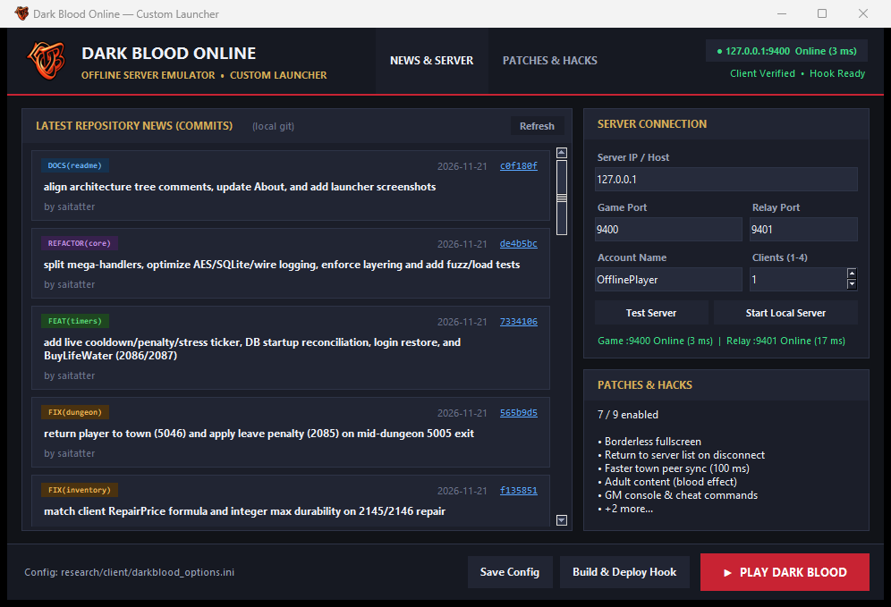
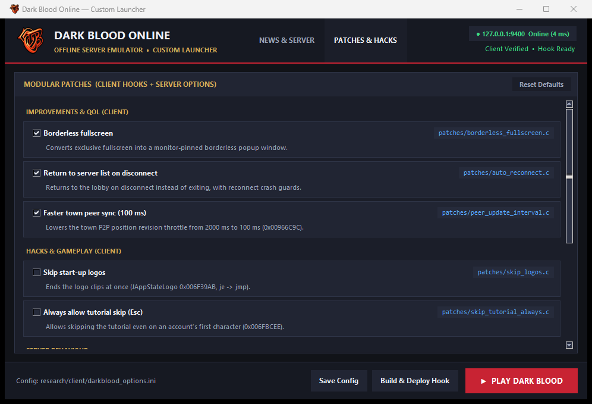

# Dark Blood Online — Offline Server Emulator

An open-source offline and LAN server emulator, modular client hook, and reverse-engineering project for **Dark Blood Online** (Steam build `1.6.5#0`).

Run the original game client locally or over LAN with real ProudNet cryptography (RSA-OAEP + AES), SQLite persistence, schema-generated typed wire messages, a custom dark-themed launcher, and 213 automated headless tests — built purely on the Python standard library.

## Supported client

The server targets exactly one build of the Steam client. All hardcoded addresses, opcode handlers and
struct layouts were recovered from it, and other builds are not supported.

| | |
| :--- | :--- |
| File | `DarkBlood.exe` (PE32 x86, 5,509,120 bytes, packed on disk) |
| SHA-256 | `a82ae3d71b596418c1f3593cb63d3f9746318d452143c2e88f6ebbaff339c931` |
| Steam app id | `267790` |
| Version label | `1.6.5#0` (from early notes; not independently verified, so rely on the hash) |

`tools/gamectl.py` refuses to start a client whose hash differs. The client files are not part of this repository.

## Custom Launcher

Launch and configure the emulator using `Launch_DarkBlood.bat` (or `python tools/launcher.py`). The launcher verifies the client binary, probes game/relay server latency, starts/stops the local server, rebuilds and deploys the modular `steam_api.dll` hook, and launches 1–4 clients with automatic multibox mutex release.

### News & Server
Displays the live repository commit feed, server connection settings (`host`, `port`, `relay_port`), account/multibox configuration, live TCP latency probes, and a summary of enabled patches.



### Patches & Hacks
Configure individual modular client hooks (`client_hook/patches/*.c`) and server-side toggles (borderless fullscreen, auto-reconnect to lobby on disconnect, 100 ms town peer sync, skip logos/tutorial, adult blood effect, native GM console, and diagnostics) without editing INI files by hand.



## Progress by system

<!-- PROGRESS:START -->
_Generated by `tools/gen_progress.py` on every push to main; do not edit by hand._

**Opcodes** are client-facing requests, replies, and notices (`eEGS_`, `eERC_`, `eERT_`) that have a schema message or server handler — including login/auth (`lobby`) and GM commands (`gm`). **Missing** is the number of remaining opcodes in that system. **Fields** is the share of fields in implemented messages whose meaning is recovered (`_` in `schemas/*.jsch` are unmapped). **Overall** = opcodes × fields. Out of scope (excluded): 13 anti-cheat & telemetry, 17 billing & monetization, 21 unused in client.

| System | Opcodes | Missing | Fields | Overall |
| :--- | ---: | ---: | ---: | :--- |
| mail | 18/18 (100%) | 0 | 54/54 (100%) | `████████████████████` 100% |
| fishing | 9/9 (100%) | 0 | 18/18 (100%) | `████████████████████` 100% |
| quests | 36/36 (100%) | 0 | 103/104 (99%) | `████████████████████` 99% |
| inventory | 90/90 (100%) | 0 | 230/233 (99%) | `████████████████████` 99% |
| skills | 23/23 (100%) | 0 | 74/77 (96%) | `███████████████████░` 96% |
| system | 36/36 (100%) | 0 | 74/82 (90%) | `██████████████████░░` 90% |
| pets | 72/74 (97%) | 2 | 150/163 (92%) | `██████████████████░░` 90% |
| party | 25/26 (96%) | 1 | 96/104 (92%) | `██████████████████░░` 89% |
| commerce | 56/59 (95%) | 3 | 131/146 (90%) | `█████████████████░░░` 85% |
| guild | 81/98 (83%) | 17 | 150/153 (98%) | `████████████████░░░░` 81% |
| events | 16/16 (100%) | 0 | 27/35 (77%) | `███████████████░░░░░` 77% |
| stalls | 28/35 (80%) | 7 | 77/97 (79%) | `█████████████░░░░░░░` 64% |
| social | 40/53 (75%) | 13 | 99/118 (84%) | `█████████████░░░░░░░` 63% |
| gm | 68/110 (62%) | 42 | 90/94 (96%) | `████████████░░░░░░░░` 59% |
| dungeon | 93/139 (67%) | 46 | 226/280 (81%) | `███████████░░░░░░░░░` 54% |
| arena | 76/202 (38%) | 126 | 183/207 (88%) | `███████░░░░░░░░░░░░░` 33% |
| lobby | 34/74 (46%) | 40 | 76/145 (52%) | `█████░░░░░░░░░░░░░░░` 24% |
| **Total** | 801/1098 (73%) | 297 | 1858/2110 (88%) | `█████████████░░░░░░░` 64% |

Every unmapped field, with the reader-address note recorded next to it, is in [docs/UNMAPPED_FIELDS.md](docs/UNMAPPED_FIELDS.md).

<details><summary>Messages and structs that still contain unmapped fields</summary>

**arena** (24)

`5098 DuelStartAck`, `ArenaSquare` ×2, `ArenaRoomInfo`, `2306 ArenaGetRoomListReq`, `5146 ArenaJoinRoomAck`, `5149 ArenaLeaveRoomAck` ×3, `2309 ArenaGetInviteListAck`, `ArenaTeamInfo`, `5275 ArenaTeamLeaveAck`, `2551 LeagueSeasonArenaGetRankAck`, `2537 LeagueSeasonCharAwardNot`, `2538 LeagueSeasonGuildAwardNot`, `5135 ArenaSquareChangeRelayAddressNot`, `2472 ArenaRandomMatchingUserCntNot`, `5173 ArenaStartGameAck` ×5, `5266 ArenaChangeRoomCharInfoAck`, `5268 ArenaChangeSlotCharInfoAck`

**commerce** (15)

`StoreRecord` ×5, `2066 StoreInfoAck`, `5070 RequestTradeAck` ×2, `5077 DeleteTradeItemReq`, `2602 MonsterCardListAck` ×2, `2609 MonsterCardDeckAck`, `2618 MonsterCardAlbumAck`, `2591 SellItemAllAck`, `2387 RouletteRollDiceAck`

**dungeon** (54)

`RoomInfo`, `RoomMember` ×17, `5004 JoinRoomAck`, `5035 RoomMemberJoinedNot`, `5036 RoomMemberLeftNot`, `5044 SelectDungeonAck`, `5014 StartGameAck` ×5, `5091 ChoiceRewardPartyRankAck` ×2, `SingleReward` ×4, `5018 FinishGameAck` ×2, `RoomMemberInfo` ×6, `5061 RoomMemInfoAck`, `2418 ServerBuffAddNot`, `2419 ServerBuffDeleteNot`, `2517 KeepBuffInsertNot` ×2, `2641 ServerBuffAdditionFishingNot`, `2291 CronosCalendarNot`, `2300 CronosStampAck`, `2654 ExploreCancelAck`, `2655 ExploreCompleteNot`, `2663 ExploreCancelByUserUidAck`, `DungeonClearRankInfo` ×2

**events** (8)

`5352 RequestTeachingAck` ×3, `5346 CitadelRewardNot`, `5362 GoldGoblinAppearNot`, `5366 GoldGoblinDeadAck` ×3

**gm** (4)

`2060 CheatItemDropAck`, `2062 CheatLearnAllSkillAck`, `2064 CheatLearnSkillAck`, `2491 CheatPetEvolutionAck`

**guild** (3)

`2570 GuildOrAttendanceAck`, `2157 GuildInfoNot`, `2158 GuildPersonListNot`

**inventory** (3)

`ItemDropEntry`, `2256 MagicEnchantEraseOptionReq`, `AddedItemNotice`

**lobby** (69)

`DepotInfo`, `2007 SelectCharacterAck` ×65, `5046 BackToSquareAck`, `RelayJoinGroupAck`, `5027 JoinLayerNot`

**party** (8)

`5049 PartyInviteReq`, `5051 PartyInviteNot` ×6, `PartyMemberInfo`

**pets** (13)

`2349 TamingMonsterInsertAck`, `2351 TamingMonsterDeleteAck`, `2435 RidingGetListAck`, `2465 PetCreateAck`, `2481 PetEatNormalAck`, `2485 PetEvolutionAck`, `2511 PetNickChangeAck`, `2436 RidingChangeListNot`, `2516 PetDyeingNot`, `2647 RidingExpireUpdateAck`, `MonsterCardInfo`, `2643 MonsterCardLottoInfoNot` ×2

**quests** (1)

`2077 QuestCompleteAck`

**skills** (3)

`QuickSlot` ×3

**social** (19)

`FriendEntry`, `5041 ChatAck` ×6, `2129 UseSpeakerItemAck`, `6012 RequestCharInfoAck` ×8, `6028 RequestItemInfoReq` ×2, `6029 RequestItemInfoAck`

**stalls** (20)

`2341 PersonalShopOpenAck` ×10, `5243 PersonalShopBuyAck` ×10

**system** (8)

`AchieveEntry` ×2, `AchieveCompletion`, `2328 AchieveGetListAck`, `2329 AchieveChangeNot` ×3, `2283 PromotionNot`

</details>
<!-- PROGRESS:END -->

---

## Current Status & Implemented Features

### 1. Connection & Protocol Security
* **ProudNet Transport & Cryptography**: Authentic RSA-OAEP + AES key exchange, packet framing, scalar/varint handling, and TCP stream reassembly.
* **Client Hook & Auto-Reconnect**: Lightweight x86 Steam API shim (`client_hook/steam_api_hook.c`) redirecting IPv4 connections to loopback, providing borderless fullscreen, and supporting seamless reconnect to the server list upon server restart.

### 2. Lobby & Character Management
* **Server & Channel Lists**: Interactive server and channel selection with live character counts.
* **Character Creation & Selection**: Full character creation for all classes (Warrior, Knight, Thief, Hunter, Mage, Fighter) persisting in SQLite (`data/darkblood.db`).
* **Game World Loading (Opcode 2007)**: Full character state serialization (attributes, stats, equipment slots, bag inventories, quickslots, active quests, locked skills).
* **Adult Blood Effect**: Unlocked and ungrayed in options menu (`m_bAdultUser = True` in welcome 5020).

### 3. World & Town Gameplay
* **Town Play**: Town square loading (Northern Elwood, etc.), local character movement, and chat broadcasts.
* **Multi-Client World Presence**: Two live clients can see each other and synchronize movement in the same town layer through the local TCP relay.
* **Channel & Layer Transitions**: Switching between channels and field layers cleanly.

### 4. Dungeons, Combat & Quests
* **Dungeon Lifecycle**: Tutorial (with skip), Act 1 dungeons, layer transitions and combat loops.
* **Dungeon Gate (5044)**: Per-character clear history unlocks difficulties in order (Normal first), and active quests unlock their quest variant of a dungeon.
* **Monster Combat & EXP**: Monster death (`5063`) grants EXP from `monster.lua`, drives level-up (`5087`) and updates the EXP bar (`5086`).
* **Loot**: Drop tables from `itemlooting.lua`, drop announcement (`5064`), item and AR pickup (`5065`/`5068`/`5114`).
* **Quest Progress Tracking**: Kill and item objectives advance active quests with HUD updates (`2075`).
* **Dungeon Result Screen (5017 / 5018)**: Clear payload with party rank, box grade and the recovered 40-byte reward block; reward chest pick (`5090`/`5091`).
* **Player Death & Revive (5093 / 5094)**: Revive UI and rebirth coins.
* **Achievements**: Counter achievements progress from the client's division reports (`2446`), complete with `2330` and list in `2328`.

### 5. Inventory & Equipment
* **Item Management**: Drag-and-drop (`2036`/`2037`), stack division (`2250`), item use (`2038`), deletion (`2040`), equip and weapon swap (`2042`), quickslots (`2044`/`2046`).
* **Appearance**: Worn gear on character-select models (`2009`), hair and skin dyeing (`2210`/`2211`) persisted through login.
* **Crafting & Upgrades**: Durability repairs (`2145`), Avatar Zam socket insertion/removal (`2362`/`2364`), item upgrades (`2115`), and spirit weapons (`2338`).
* **Depot**: Gold deposits and withdrawals (`2228`–`2231`), shared depot expiry (`2242`), slot expansion (`2461`).

### 6. Skills & Combat Abilities
* **Skill Learning**: Single skill learning (`2050`) and full skill tree batch learning (`2697`/`2698`).
* **Skill State**: Skill lock/unlock toggles (`2117`/`2118`), skill speech macros (`2053`/`2055`), and skill book consumption (`2111`).

### 7. Commerce, Cash Shop & Social
* **NPC Stores & Buyback**: Store info catalogs (`2065`), item purchases with gold verification (`2067`), item selling (`2069`), and buyback (`2071`).
* **Offline Steam Cash Shop**: In-game cash shop purchases (`2712` -> unsolicited `2037` items + `2714`), cash packages (Type 36) and random boxes opening into bag slots.
* **Player-to-Player Trade**: Request, accept, item placement, gold stakes, lock, and completion (`5069`–`5084`).
* **Social & Guilds**: Friend list management, online presence notifications, memos, guild creation, guild bank deposits/withdrawals, guild level-up, and duel requests.

---

## Architecture & Codebase

<!-- ARCHITECTURE:START -->
_Generated by `tools/gen_progress.py` on every push to main; do not edit by hand._

The server is a Python package laid out like MHServerEmu so it can be ported to C# later:

```text
src/darkblood/
├── core/                     # Shared infrastructure: networking, crypto, serialization (C#: DarkBlood.…
│   ├── network/              # ProudNet framing and encryption
│   │   ├── crypto.py         # ProudNet session crypto as recovered from the Dark Blood client
│   │   └── proudnet.py       # Dark Blood's observed ProudNet framing (x86 client 1.6.5#0)
│   ├── serialization/        # JSerBuffer / JEvent encoding
│   │   ├── jser.py           # JSerBuffer / JEvent primitives recovered from client 0xA1EB90/0xB35E50
│   │   └── wire.py           # Typed JSerBuffer wire serialization (WireMessage + JSerBufferWriter)
│   ├── hashing.py            # JHashString (client 0x00B3B5A0)
│   └── options.py            # Shared configuration in research/client/darkblood_options.ini (edited by…
├── frontend/                 # Client-facing listeners: game connection and relay (C#: DarkBlood.Fronte…
│   ├── relay.py              # Square/room relay endpoint and relay PIDL (JoinGroup/JoinGroupACK)
│   └── server.py             # Loopback ProudNet server for the Dark Blood client
├── games/                    # Game logic (C#: DarkBlood.Games)
│   ├── entities/             # Characters, items, bags
│   │   ├── character.py      # Player character entity and its wire encodings (lobby entry, world detai…
│   │   └── items.py          # Items and bag containers (client structs 0x00A53F50 / 0x00A1EC30)
│   ├── game_data/            # Readers for the client's own data tables (Data/Dict)
│   │   ├── cash_shop.py      # Server-owned catalog for offline Cash Shop purchases
│   │   ├── client_dict.py    # Unified facade re-exporting domain game-data tables (items, stores, ques…
│   │   ├── items.py          # Item prices, durabilities, starter gear, cash packages, random boxes and…
│   │   ├── loader.py         # Shared asset path resolution, test override lookup and Lua dict section …
│   │   ├── progression.py    # Character level stats, level-up AP, skill learning costs and achievement…
│   │   ├── quests.py         # Quest rewards, item groups and monster/item/dungeon mission objective ta…
│   │   ├── stores.py         # NPC store catalog tables (npcs.tsv, stores.tsv)
│   │   └── world.py          # Monster stats, loot tables, money drops, dungeon maps and gate listings
│   ├── handlers/             # JEvent handlers grouped by game domain (mixins of GameSession)
│   │   ├── commerce/         # Commerce domain controller composed from stores, cash shop, trade and st…
│   │   │   ├── cash_shop.py  # Offline Steam Cash Shop, cash packages, HTTP notices and play options
│   │   │   ├── stalls.py     # Personal shops (town stalls) and Broker (Auction House) handlers
│   │   │   ├── stores.py     # NPC store catalog, buying, selling, buyback, beauty shop, roulette and d…
│   │   │   └── trade.py      # Player-to-player trade request, item/gold staking and completion
│   │   ├── dungeon/          # Dungeon domain controller composed from rooms, combat and events mixins
│   │   │   ├── combat.py     # Dungeon start, layer transitions, monster kills, loot drops/pickups, dea…
│   │   │   ├── events.py     # Cronos attendance, Explore, Clear Rank, war flags and dungeon telemetry
│   │   │   └── rooms.py      # Dungeon room creation, joining, leaving, host promotion, gate selection …
│   │   ├── inventory/        # Inventory domain controller composed from responsibility-focused mixins
│   │   │   ├── bags.py       # Bag management and quickslot handlers (2026, 2028, 2030, 2032, 2044, 204…
│   │   │   ├── crafting.py   # Upgrading, durability repair, enchanting, avatar/zam, smelting and mark …
│   │   │   ├── depot.py      # Depot / warehouse gold and slot handlers (2228, 2230, 2242, 2461)
│   │   │   └── items.py      # Core item movement, equip, consumption, dyeing, splitting and sealing ha…
│   │   ├── social/           # Social domain controller composed from friends, chat, party and guild mi…
│   │   │   ├── chat.py       # Town/party/whisper chat, speaker items and GM slash commands
│   │   │   ├── friends.py    # Friends, block list, character/item inspection, achievements and system …
│   │   │   ├── guild.py      # Guild creation, roster, bank, skills, broker, siege and citadel handlers
│   │   │   └── party.py      # Party invites, joins, kicks and teaching/guide/summon handlers
│   │   ├── arena.py          # Arena matches, teams, ladder rankings, and 1v1 town duels handlers
│   │   ├── base.py           # Shared access to the owning game session
│   │   ├── frontend.py       # Frontend flow: server/channel lists, character list, creation and select…
│   │   ├── gm.py             # Native GM Console & Cheat command handlers (eEGS_CHEAT_* / eERC_CHEAT_*)
│   │   ├── mail.py           # Mailbox (Post) system handlers for Dark Blood Online
│   │   ├── pets.py           # Pet, Mount and Taming domain handlers
│   │   ├── quests.py         # Quest start/complete, failure, abandon, and tutorial quest handlers
│   │   ├── skills.py         # Skill learning, quickslots, locked skills, cooltime display, dual skill,…
│   │   └── square.py         # Town (square) play: tutorial, layers, NPCs, waypoints
│   ├── missions/             # Quests
│   │   └── quests.py         # Quest state carried in 2007 (active-quest map 0x00A3E450)
│   ├── network/              # Game message definitions
│   │   ├── messages/         # 17 schema-generated typed WireMessage modules
│   │   └── results.py        # Client result codes (JERI_*) for ACK `result` fields
│   ├── achievements.py       # Counter achievements (DictAchieve Type 0) driven by 2446 division report…
│   ├── config.py             # Local offline world configuration: server list, channels, slots
│   ├── dispatcher.py         # Route client JEvents to asynchronous domain handlers
│   ├── loot.py               # Monster drops from itemlooting.lua (DictItemDrop), rolled on 5063
│   ├── progression.py        # Character level, ability point, and stress (fatigue) accounting
│   ├── session.py            # Game connection session (JEvent dispatcher)
│   ├── stalls.py             # Personal Shop (Player Stalls in town) and Market / Auction House (Broker…
│   └── world.py              # Multi-client Game World Manager and Party Subsystem
├── player_management/        # Accounts and character persistence (C#: DarkBlood.PlayerManagement)
│   ├── characters.py         # Local character storage and the client's character struct
│   └── store.py              # Character storage: the ICharacterStore interface and its SQLite backend
└── __main__.py               # Entry point: ``python -m darkblood`` (with src/ on sys.path) or ``python…

client_hook/
├── patches/                  # 8 modular patches: auto_reconnect, borderless_fullscreen, debug_tools, diagnostic_hooks, network_redirect, peer_update_interval, skip_logos, skip_tutorial_always
├── build.bat
├── common.c
├── common.h
└── steam_api_hook.c          # Dark Blood offline Steam API shim & modular patch loader.

schemas/                      # 17 JSerBuffer wire schema domains (*.jsch -> tools/gen_messages.py)
tools/                        # launcher.py, gamectl.py, multibox.py, mcp_server.py, headless_client.py, gen_*.py
```
<!-- ARCHITECTURE:END -->

See [docs/ARCHITECTURE.md](docs/ARCHITECTURE.md) for the rules and the porting plan, and
[docs/OPCODE_REGISTRY.md](docs/OPCODE_REGISTRY.md) (generated) for every opcode's status.

---

## Automated Test Suite

The emulator includes **headless integration and unit tests** for network handshakes and protocol flows without launching graphics windows:

```bash
python -m unittest discover -s tests -v
```

* Tests cover: lobby handshake, character creation, SQLite storage, world entrance, monster EXP, dungeon gate history and result screen, inventory, depot and dyeing, quest progression, achievements, party invites, cash shop, arena duels, and wire serialization.

---

## Running Locally

### Prerequisites
* Windows OS
* Python 3.8+ (with `pefile` and `capstone`)
* MSVC x86 build tools (Visual Studio Community 2022)

### Cash Shop catalog

The repo ships the default purchase catalog at `assets/cash_shop.tsv`.
To replace it on your server, put a complete catalog in `data/cash_shop.tsv`
(or `$DARKBLOOD_DATA/cash_shop.tsv` when the server data directory is configured).
Use UTF-8 tab-separated columns `product_id`, `item_code`, and `quantity` and
match the product IDs sent by the client. Restart the server after editing a
loaded catalog. Offline purchases are free.

To populate a new catalog from an existing local extraction, run
`python tools/import_cash_shop.py`. The importer searches
`lua_src/data/dict/item_cash.lua` under `DARKBLOOD_CLIENT_DATA` or the adjacent
`darkblood-client-data` directory. It also accepts an explicit `--source` path
and creates a local override without overwriting an existing catalog.

Purchases use the TSV at runtime. Package and random box contents come from
`assets/cash_packages.tsv` and `assets/random_boxes.json`. Players connecting
to the server need no Cash Shop configuration.

### Game data

The server runs from the normalized tables in `assets/` and needs no extracted
client data. `python tools/export_assets.py` regenerates them from an extracted
client (`DARKBLOOD_CLIENT_DATA` or the adjacent `darkblood-client-data`).

### 1. Build & Deploy Client Hook
Build the x86 redirect hook with the game client closed:

```powershell
client_hook\build.bat
Copy-Item client_hook\steam_api.dll research\client\steam_api.dll
```

### 2. Start the Server
Run the local server from the repository root:

```powershell
python run_server.py
```
*Port `9400` handles game traffic; port `9401` handles relay traffic.*

### 3. Launch Client (Custom Launcher)
Use the custom launcher (`Launch_DarkBlood.bat` or `python tools\launcher.py`) to configure the target server IP/port, toggle individual client patches (`client_hook/patches/*.c`) and server options, rebuild/deploy `steam_api.dll`, and launch 1–4 clients:

```powershell
python tools\launcher.py
```

Or launch the working client in `research\client\` directly:

```powershell
$env:__COMPAT_LAYER = 'RunAsInvoker'
.\research\client\DarkBlood.exe
```

### 4. CLI & MCP Automation (`gamectl`)
Manage server and game automation with `tools/gamectl.py`:

```powershell
python tools\gamectl.py start          # Start server + client
python tools\gamectl.py enter-lobby    # Skip intro, pick server and channel
python tools\gamectl.py events         # Tail decoded protocol events
python tools\gamectl.py stop           # Stop processes
```

*An MCP stdio server is available via `.mcp.json` (`tools/mcp_server.py`) exposing automated gameplay, screenshot, and inspection tools.*

---

## Documentation

* [Session Handoff](docs/SESSION_HANDOFF.md): Latest findings, active tasks, and verified breakthroughs.
* [Research Status](docs/STATUS.md): Reverse-engineering notes, evidence logs, and memory offsets.
* [Recovered Protocol](docs/PROTOCOL.md): Wire framing, opcode tables, and client handler addresses.
* [Opcode Registry](docs/OPCODE_REGISTRY.md): Generated per-opcode status (`python tools/gen_opcode_registry.py`).
* [GM Console Commands](docs/GM_COMMANDS.md): Reference for all 123 native GM console commands and chat slash commands.
* [Unmapped Fields](docs/UNMAPPED_FIELDS.md): Generated list of wire fields whose meaning is not recovered (`python tools/gen_progress.py`).
* [Architecture](docs/ARCHITECTURE.md): Package layout, rules, and porting notes.
* [Roadmap](ROADMAP.md): Milestones, priority items, and development trajectory.
* [Agent Guidelines](AGENTS.md): Working instructions, commit conventions, and synchronization rules.

---

## Next Steps

The open work (shared dungeon instances, town movement desync, guild war, C# port) is tracked in
[ROADMAP.md](ROADMAP.md). The fields still sent as zero are listed in
[docs/UNMAPPED_FIELDS.md](docs/UNMAPPED_FIELDS.md).

---

## License

Copyright (C) 2026 the Dark Blood server emulator contributors.

This program is free software: you can redistribute it and/or modify it under
the terms of the GNU Affero General Public License as published by the Free
Software Foundation, either version 3 of the License, or (at your option) any
later version. It is distributed WITHOUT ANY WARRANTY; see [LICENSE](LICENSE)
for the full text. If you run a modified version as a network service, the
AGPL requires you to offer its users the corresponding source code.

The license covers this repository's source and documentation only. The Dark
Blood client, its game data and any extracted assets are not part of this
project and are not covered by it.
